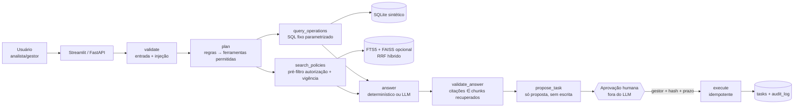

# Copiloto de Operações

Agente de IA para uma **empresa fictícia de e-commerce** que responde, em português, perguntas
sobre pedidos, cancelamentos, entregas e políticas internas — combinando **consultas
determinísticas** (SQLite) com **recuperação de documentos** (RAG) — e propõe uma **tarefa
operacional** que só é registrada após **aprovação humana explícita**.

> Projeto pessoal de portfólio. Todos os dados, políticas e usuários são **sintéticos**.
> Roda 100% local, sem chave de API obrigatória. Não é um sistema em produção.

## Pergunta principal da demonstração

> "Por que os cancelamentos aumentaram neste mês e quais ações podemos tomar?"

O sistema consulta os dados (taxa por segmento/transportadora, motivos, SLA, chamados), recupera
as políticas vigentes autorizadas para o usuário, apresenta números com fontes clicáveis e propõe
uma tarefa. Um **gestor** aprova ou rejeita; só então a tarefa é registrada (idempotente).

## Instalação e execução

Requisitos: Python 3.11+ (testado com 3.12 no Windows).

```bash
python -m venv .venv
.venv\Scripts\activate            # Windows  |  source .venv/bin/activate  # Linux/macOS
pip install -e ".[dev]"           # núcleo + testes (sem downloads de modelos)
copy .env.example .env            # opcional; o padrão já funciona sem LLM

copiloto generate-data            # dados sintéticos (seed fixa) -> data/synthetic/copiloto.db
copiloto ui                       # interface Streamlit (modo determinístico por padrão)
copiloto api                      # API FastAPI em http://127.0.0.1:8000/docs
pytest                            # suíte de testes
copiloto eval                     # casos de avaliação -> evals/results/*.json
```

### Habilitar LLM local (Ollama)

```bash
ollama pull qwen3.5:9b            # ou outro modelo; ajuste COPILOTO_OLLAMA_MODEL
# .env: COPILOTO_LLM_PROVIDER=ollama
copiloto eval --llm               # avaliação com inferência real
```

Validado neste repositório com `qwen3.5:9b` em RTX 4070 Laptop / 32 GB RAM. Em CPU a latência
é bem maior. Gemini (`COPILOTO_LLM_PROVIDER=gemini` + `GEMINI_API_KEY`) é opcional; a
disponibilidade de cota gratuita depende das condições vigentes do provedor.

### Habilitar busca vetorial/híbrida

```bash
pip install -e ".[vector]"        # sentence-transformers + faiss-cpu (baixa o modelo de embeddings)
# .env: COPILOTO_RETRIEVAL_MODE=hybrid
copiloto eval --variants lexical,hybrid,vector
```

Sem essas dependências, o sistema opera em modo **lexical** (SQLite FTS5/BM25) e informa isso.

## Arquitetura



Estados: `received → analyzing → retrieving → answer_ready → awaiting_approval →
approved | rejected → executed`, além de `insufficient` e `failed`.

Detalhes em [`docs/architecture.md`](docs/architecture.md); decisões em
[`docs/decisions/`](docs/decisions/); resultados em [`docs/evaluation.md`](docs/evaluation.md).

## O que está implementado

| Área | Estado |
|---|---|
| Dados sintéticos (3 meses, seed fixa, pico artificial em assinante × RapidoLog) | Implementado e testado |
| 12 documentos de política com versão/vigência/acesso + 2 maliciosos de teste | Implementado |
| `query_operations` (6 consultas fixas, parâmetros validados, somente leitura) | Testado |
| `search_policies` lexical (FTS5) com pré-filtro de autorização e vigência | Testado |
| Busca vetorial (sentence-transformers + FAISS) e híbrida (RRF) | Implementado; comparação em `docs/evaluation.md` |
| Agente LangGraph com limites, validação de citações, modo sem LLM | Testado |
| Provedores `none` / Ollama / Gemini com interface única | Ollama validado localmente; Gemini implementado, não executado |
| Aprovação humana: hash, TTL, papel, revogação por edição, idempotência | Testado |
| API FastAPI + UI Streamlit + rastreio por execução + logs JSON | Testado (UI headless) |
| 33 casos de avaliação versionados + runner com métricas | Executado (ver relatório) |
| Reranking local | Planejado, não implementado |
| MCP, PDF/OCR, autenticação real | Fora do MVP |

## Segurança (controles implementados, não garantias)

- Ferramentas com contratos Pydantic estreitos e lista fechada; **nenhum SQL vem do LLM**.
- Autorização por papel aplicada **no backend antes do ranking**: trechos restritos nunca
  entram no contexto de quem não tem acesso.
- Dados e documentos entram no prompt rotulados como conteúdo não confiável; padrões de
  injeção são sinalizados na entrada e nos documentos; o LLM não tem ferramenta de escrita.
- Citações inexistentes são removidas e registradas como limitação.
- Aprovação vinculada a hash do conteúdo + usuário gestor + prazo; edição revoga; retry
  não duplica (chave de idempotência).
- Logs com redaction de segredos e sem contexto integral.
- **Limitações**: autenticação é de demonstração; detecção de injeção por padrões é
  complementar, não suficiente sozinha; ver [`docs/limitations.md`](docs/limitations.md).

## Custos

Rodar local não gera cobrança de serviço externo (há custo de hardware e energia). A interface
mostra **tokens reportados pelo provedor** separados de **tokens estimados** (~4 chars/token) e
**não exibe valor em dinheiro**, pois não há tabela de preços embutida.

## Estrutura

```
src/copiloto/
  agents/        grafo LangGraph, planner por regras, prompts versionados, validação
  tools/         contratos + query_operations + search_policies
  retrieval/     ingestão, FTS5, FAISS opcional, retriever com RRF e pré-filtro
  providers/     interface LLM: none | ollama | gemini
  approval.py    aprovação/execução idempotente (fora do LLM)
  api/ ui/       FastAPI e Streamlit
  observability/ tracer com run_id, etapas, tokens, logs JSONL
  evals/         runner, checks, fluxos e métricas
data/policies/   documentos sintéticos      data/synthetic/  CSVs + banco gerado
evals/cases.json 33 casos                   evals/results/   relatórios reais
docs/            arquitetura, decisões, limitações, avaliação, roteiro, post
```

## Licença

MIT. Dados e documentos são sintéticos e podem ser redistribuídos.

