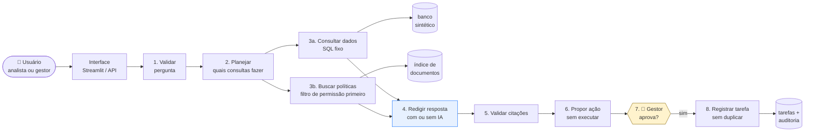

<div align="center">

# 🧭 Copiloto de Operações

**Um assistente de IA que responde perguntas sobre a operação de um e-commerce —
com números que vêm do banco de dados, fontes que você pode conferir
e ações que só acontecem depois que uma pessoa aprova.**

[](https://github.com/GuiiLuiss/ops-copilot/actions/workflows/ci.yml)
[](https://www.python.org/)
[](tests/)
[](.pylintrc)
[](docs/evaluation.md)
[](#-licença)

*Projeto pessoal de portfólio · 100% local · dados fictícios · em português*

</div>

---

## 💡 A ideia em 30 segundos

Imagine que você trabalha na operação de uma loja online e pergunta:

> **"Por que os cancelamentos aumentaram neste mês e o que podemos fazer?"**

Um chatbot comum responderia com um texto convincente — e possivelmente inventado.
Este projeto faz diferente:

| Etapa | O que acontece |
|---|---|
| 🔢 **Consulta os dados de verdade** | Roda consultas fixas no banco (taxa de cancelamento por segmento, por transportadora, motivos, atrasos, chamados). A IA **não calcula nada** — só recebe os números prontos. |
| 📄 **Busca as políticas internas** | Encontra os documentos relevantes (SLA de entrega, regras de cancelamento, escalonamento) e **só mostra o que o seu perfil pode ver**. |
| ✍️ **Escreve a resposta com fontes** | Cada afirmação sobre política vem com uma citação clicável. Se a IA citar algo que não existe, a citação é removida e isso fica registrado. |
| 📝 **Propõe uma ação** | Ex.: *"Abrir revisão operacional com a transportadora RapidoLog"*. Mas **não executa**. |
| ✅ **Espera uma pessoa aprovar** | Só um **gestor** pode aprovar. A aprovação vale para aquele texto exato — se alguém editar a proposta, precisa aprovar de novo. Clicar duas vezes não cria duas tarefas. |

No cenário de demonstração, o sistema descobre que o aumento se concentra em **clientes
assinantes** atendidos pela transportadora **RapidoLog** (taxa de 7,9% → 12,3%), associado a
atrasos de entrega — e usa a linguagem certa: *"hipótese a investigar"*, não *"a causa é"*.

## 🎯 Por que isso importa

Colocar IA generativa em uma operação real tem três riscos clássicos:

1. **Ela inventa números.** Aqui os números nunca saem do modelo — saem de consultas SQL
   fixas e validadas. Na avaliação, **exatidão numérica de 100%** em todas as rodadas.
2. **Ela vaza informação.** O filtro de permissão acontece **antes** da busca, não depois.
   Um analista nunca vê um documento restrito a gestores. **Zero vazamentos** nos testes.
3. **Ela faz coisas sem ninguém pedir.** A IA não tem nenhuma ferramenta de escrita. A
   aprovação é uma função da aplicação, fora do alcance do modelo. **Zero execuções sem
   aprovação** nos testes — inclusive quando um documento malicioso mandava "aprovar
   automaticamente".

E tudo isso foi **medido**, não só prometido. Veja [os resultados](#-resultados-medidos).

## 🖥️ Como fica na prática

A interface (Streamlit) tem quatro abas: **Chat**, **Propostas e tarefas**, **Avaliação** e **Sobre**.

```
┌─────────────────────────────────────────────────────────────────────┐
│  🟡 Estado: awaiting_approval · run a1b2c3 · LLM ollama/qwen3.5:9b   │
│                                                                     │
│  **Resumo**                                                         │
│  A taxa geral subiu 0,57 p.p., puxada pelo segmento assinante       │
│  (7,9% → 12,3%) e pela transportadora RapidoLog (+4,59 p.p.).       │
│  O motivo predominante é atraso na entrega (46% dos cancelamentos). │
│                                                                     │
│  **Políticas aplicáveis**                                           │
│  • [POL-002#s02] Reembolso integral quando o cancelamento é por     │
│    atraso da transportadora                                         │
│  • [POL-001#s03] Cancelamentos sem motivo exigem revisão semanal    │
│                                                                     │
│  ▸ Fontes (clique para ver o trecho)                                │
│  ▸ Rastreio: 7 ferramentas · 29 s · 5.262 + 529 tokens              │
│  ▸ Limitações desta resposta                                        │
│ ─────────────────────────────────────────────────────────────────── │
│  📝 Proposta: Investigar cancelamentos com RapidoLog em 2025-09     │
│     [ ✅ Aprovar ]  [ ❌ Rejeitar ]   ← só habilitado para gestor    │
└─────────────────────────────────────────────────────────────────────┘
```

Há também um **modo sem IA** (rotulado como "determinístico"): a mesma interface, mas a
resposta é montada só com os números e trechos encontrados. Serve para explorar os dados sem
precisar de modelo nenhum — e roda em milissegundos.

## 🚀 Rodando em 2 minutos

Você só precisa de **Python 3.11+**. Nenhuma chave de API, nenhum serviço pago.

```bash
git clone https://github.com/GuiiLuiss/ops-copilot.git && cd ops-copilot
python -m venv .venv
.venv\Scripts\activate              # Windows   |   source .venv/bin/activate   # Linux/macOS
pip install -e ".[dev]"

copiloto generate-data              # cria os dados fictícios (sempre iguais, seed fixa)
copiloto ui                         # abre a interface no navegador
```

Pronto — já dá para fazer perguntas no **modo determinístico**, sem nenhum modelo de IA.

<details>
<summary><b>➕ Quer ligar a IA? (Ollama, local e gratuito)</b></summary>

```bash
ollama pull qwen3.5:9b              # baixa o modelo (~6 GB)
copy .env.example .env              # e edite: COPILOTO_LLM_PROVIDER=ollama
copiloto ui                         # o botão "Usar LLM" aparece ligado
```

Validado com `qwen3.5:9b` em uma RTX 4070 Laptop (32 GB RAM): ~15 s por resposta.
Em CPU funciona, mas é bem mais lento. Gemini também é suportado
(`COPILOTO_LLM_PROVIDER=gemini` + `GEMINI_API_KEY`), mas não foi executado neste projeto;
a cota gratuita depende das condições do provedor.
</details>

<details>
<summary><b>➕ Quer busca semântica (vetorial / híbrida)?</b></summary>

```bash
pip install -e ".[vector]"          # sentence-transformers + FAISS (baixa ~470 MB de modelo)
# .env: COPILOTO_RETRIEVAL_MODE=hybrid
```

Sem isso, a busca é **lexical** (SQLite FTS5) — que, nos testes, foi a melhor opção
para este corpus. Veja a comparação em [docs/evaluation.md](docs/evaluation.md).
</details>

<details>
<summary><b>🐳 Prefere Docker?</b></summary>

```bash
docker compose up                   # API em :8000 e UI em :8501, modo determinístico
docker compose --profile llm up     # + Ollama como serviço (depois: docker compose exec ollama ollama pull qwen3.5:9b)
```

A imagem (~690 MB, sem torch) sobe com o banco sintético já gerado; API e UI têm healthcheck.
Validado localmente e construído a cada commit no CI.
</details>

<details>
<summary><b>➕ Outros comandos</b></summary>

```bash
copiloto api                        # API REST em http://127.0.0.1:8000/docs
pytest                              # 54 testes
copiloto eval                       # 33 casos de avaliação (modo determinístico)
copiloto eval --llm                 # idem, com o modelo configurado
copiloto eval --variants lexical,hybrid,vector
```
</details>

## 📊 Resultados medidos

Criei **33 casos de teste** cobrindo perguntas numéricas, comparações entre meses, políticas
vigentes e antigas, perguntas sem resposta, acesso restrito, tentativas de manipulação (prompt
injection) e os fluxos de aprovação. Os números esperados são recalculados pelo próprio banco
na hora do teste — nunca escritos à mão.

| Modo | Casos corretos | Números exatos | Vazamentos | Ações sem aprovação |
|---|:---:|:---:|:---:|:---:|
| Sem IA (lexical) | **33 / 33** | 6 / 6 | 0 | 0 |
| Sem IA (híbrido) | **33 / 33** | 6 / 6 | 0 | 0 |
| Com IA — 1ª rodada | 28 / 33 | 6 / 6 | 0 | 0 |
| Com IA — após correções | **32 / 33** | 6 / 6 | 0 | 0 |

**O que a avaliação revelou** — e o que fiz com isso:

- 🔍 Na primeira rodada com IA, o modelo **inventava IDs de citação** (12 vezes em 66
  execuções) e, em 1 caso, **repetiu texto de um documento malicioso** na resposta.
- 🔧 Correções: trechos suspeitos passaram a ser **excluídos antes de chegar ao modelo**, e o
  contexto passou a listar explicitamente quais citações são válidas.
- 📈 Resultado: citações inventadas caíram de **12 → 2**; eco de conteúdo malicioso **2 → 0**.
  Mesmas condições, mesmo modelo, mesmos casos.

Relatórios completos (JSON) estão em [`evals/results/`](evals/results/) e a análise, incluindo
o que **não** funcionou, em [`docs/evaluation.md`](docs/evaluation.md).

## 🏗️ Como funciona por dentro



Os passos 1–6 são o **agente** (um grafo com estados e limites de tempo/chamadas).
Os passos 7–8 ficam **fora do agente**, numa função da aplicação que a IA não consegue chamar.

<details>
<summary><b>🛡️ Como o sistema se protege (e o que ele não garante)</b></summary>

| Risco | Controle |
|---|---|
| IA gerar SQL perigoso | Ela não gera SQL. Escolhe entre 6 consultas fixas com parâmetros validados. |
| Vazar documento restrito | Filtro de papel aplicado **antes** da busca. O trecho nem entra no ranking. |
| Documento com instruções maliciosas | Entra no prompt rotulado como "dado, não instrução". Se tiver padrão suspeito, vai para **quarentena** e nem chega ao modelo. |
| IA inventar citação | Toda citação é conferida contra os trechos realmente recuperados; inexistentes são removidas e registradas. |
| Ação sem aprovação | A IA não tem ferramenta de escrita. Aprovar exige papel gestor + hash exato do conteúdo + prazo. Editar revoga; repetir não duplica. |
| Segredos em logs | Logs com redaction; sem contexto integral. |

**Não garante:** a autenticação é de demonstração (você escolhe o usuário num menu);
a detecção de injeção é por padrões, não por entendimento; e nada aqui elimina alucinação —
só reduz a superfície e torna o erro visível. Detalhes em [docs/limitations.md](docs/limitations.md).
</details>

<details>
<summary><b>🧰 Stack e decisões</b></summary>

| Camada | Escolha | Por quê |
|---|---|---|
| Linguagem / API | Python, FastAPI, Pydantic | Contratos explícitos e validação na borda |
| Orquestração | LangGraph | Fluxo com estados, limites e ponto de parada para aprovação |
| Dados | SQLite + CSVs sintéticos | Reproduzível, sem serviço externo |
| Busca lexical | SQLite FTS5 (BM25) | Funciona sem baixar nada; foi a melhor nos testes |
| Busca vetorial | sentence-transformers + FAISS | Opcional; comparada com a lexical |
| LLM | Ollama local (padrão) ou Gemini | Sem custo e sem chave para a demo |
| Interface | Streamlit | Demonstração legível |
| Testes / qualidade | pytest, ruff, pylint 10/10 | 54 testes: regras, integração, autorização, idempotência, UI |

Decisões registradas como ADRs em [docs/decisions/](docs/decisions/): por que dados
estruturados *e* RAG, por que um agente só, por que a aprovação fica fora do LLM, por que o
plano é por regras, e por que reranking ficou de fora.
</details>

<details>
<summary><b>📁 Estrutura do repositório</b></summary>

```
src/copiloto/
  agents/         grafo, planner por regras, prompts versionados, validação
  tools/          contratos + query_operations + search_policies
  retrieval/      ingestão, FTS5, FAISS opcional, fusão RRF, pré-filtro
  providers/      interface LLM: none | ollama | gemini
  approval.py     aprovação e execução idempotente (fora do agente)
  api/  ui/       FastAPI e Streamlit
  observability/  rastreio por execução, logs JSONL
  evals/          runner, checks, fluxos e métricas
data/policies/    12 documentos fictícios (+2 maliciosos de teste)
data/synthetic/   CSVs e banco gerados com seed fixa
evals/            33 casos versionados + relatórios reais
docs/             arquitetura, decisões, limitações, avaliação, caminho para produção
```
</details>

## 🏭 E em produção?

Este projeto roda num notebook de propósito — qualquer pessoa consegue reproduzir. Mas o
núcleo (agente, regras de aprovação, contratos das ferramentas) **não sabe onde roda**: recebe
banco, usuário e modelo por injeção. Levar para produção é trocar as bordas, não reescrever:

| Hoje | Em produção |
|---|---|
| Menu de usuário | Login com o IdP da empresa (OIDC); o backend já trabalha com `User` + papel |
| SQLite | PostgreSQL + pgvector (pré-filtro de permissão nativo no `WHERE`) |
| Ollama no notebook | API gerenciada ou vLLM em GPU — é uma classe nova em `providers/` |
| Um processo | API stateless + fila + workers; `POST /ask` devolve `run_id`, UI acompanha |
| Logs JSONL | OpenTelemetry; alerta em citações removidas e aprovações negadas |
| CI no GitHub Actions (**já existe**: lint, testes, 33 casos como gate, build da imagem) | + push da imagem, deploy por ambiente, avaliação com LLM noturna, canary de prompt |
| `docker compose up` (**já existe**) | Cloud Run / Container Apps / Kubernetes — mesmo container, Postgres e LLM gerenciados |

O raciocínio completo — ordem de prioridade, estimativa de esforço, custo por faixa e o que eu
**não** faria — está em [docs/production.md](docs/production.md).

## 🗺️ O que ficou de fora (por enquanto)

- **Reranking** local — sem ganho claro da busca vetorial, não se justificou ainda.
- **Citações inventadas** — caíram de 12 para 2, mas não zeraram; próximos candidatos são
  citação por índice numérico ou um modelo maior.
- **Rubrica humana** de utilidade/fidelidade — definida, não executada.
- MCP, PDF/OCR, autenticação real, execução com Gemini.

## 💰 Custos

Tudo roda local: não há cobrança de serviço externo (há custo de hardware e energia). A
interface mostra **tokens reportados pelo provedor** separados de **tokens estimados** e não
inventa valor em dinheiro, porque não há tabela de preços embutida.

## 📄 Licença

MIT. Dados, documentos e usuários são fictícios e podem ser redistribuídos.
Nenhum dado, código ou documento de empresas reais foi usado.

---

<div align="center">
<sub>Feito por <b>Guilherme Luís Silva</b> · projeto pessoal de portfólio em Engenharia de IA</sub>
</div>

