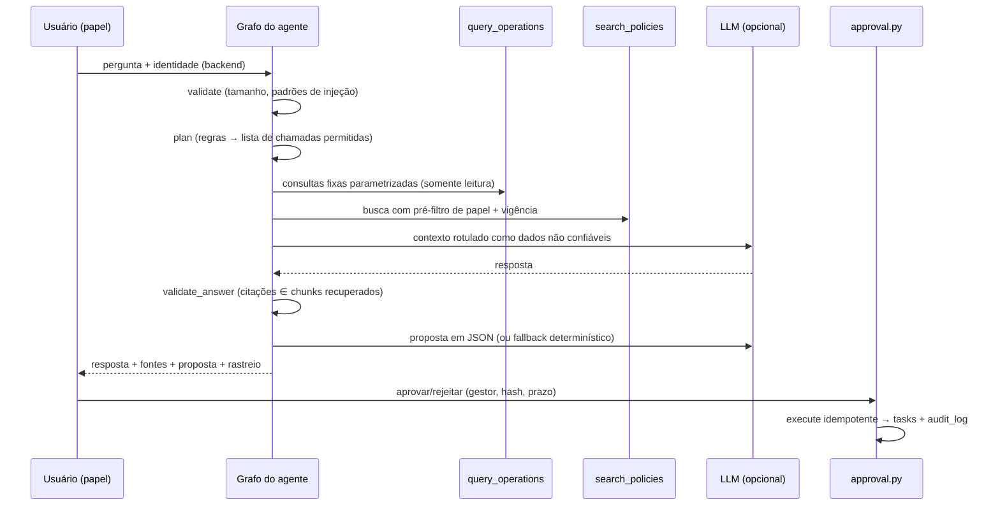

# Arquitetura

## Visão geral

O Copiloto é um **único agente** com três ferramentas de contrato estreito, um grafo de estados
(LangGraph) com limites explícitos e uma camada de **aprovação humana fora do agente**.

## Componentes

| Módulo | Responsabilidade |
|---|---|
| `data/generate.py` | Dados sintéticos com seed fixa; pico artificial no mês de referência |
| `tools/contracts.py` | Contratos Pydantic de entrada/saída das três ferramentas |
| `tools/query_operations.py` | Seis consultas SQL fixas; dimensões em lista fechada; `COALESCE` para meses vazios |
| `retrieval/ingest.py` | Front matter → metadados; chunking por seção; dedup por hash; versão do índice |
| `retrieval/lexical.py` | SQLite FTS5 (BM25 nativo, `unicode61 remove_diacritics`) |
| `retrieval/vector.py` | sentence-transformers + FAISS `IndexFlatIP`; cache `.npz` por versão do índice |
| `retrieval/retriever.py` | Pré-filtro de autorização/vigência → ranking → RRF (k=60) |
| `agents/planner.py` | Intenção e plano por regras (não pelo LLM) |
| `agents/graph.py` | Grafo `validate → plan → tools → answer → propose` |
| `agents/render.py` | Contexto para LLM, resposta determinística, validação de citações |
| `providers/` | Interface `LLMProvider`; `none`, Ollama (HTTP), Gemini (REST) |
| `approval.py` | Propostas, decisão, execução idempotente, auditoria |
| `observability/tracer.py` | `run_id`, etapas, ferramentas, tokens, logs JSONL com redaction |
| `evals/` | 33 casos, checks, fluxos de aprovação, métricas, relatório |

## Limites e falhas controladas

- `max_tool_calls` (padrão 6) corta o plano; `search_policies` é colocada primeiro para nunca
  ser cortada.
- `MAX_CONTEXT_CHARS = 24 000`; contexto truncado é registrado como limitação.
- `llm_timeout_seconds` (padrão 120); `ProviderError` cai para resposta determinística.
- Proposta via LLM: **uma** tentativa; JSON inválido → fallback determinístico (contado em
  `retries`).
- Qualquer exceção não tratada termina em `failed` com mensagem curta e rastreio salvo.
- Não há loop de autocorreção.

## Por que o plano é por regras e não pelo LLM

- Mantém a lista de ferramentas fechada e auditável.
- Permite o modo **sem LLM** ser útil (explorar dados e políticas).
- Reduz chamadas e latência: o LLM só redige a partir de evidências prontas.
- Custo: perguntas fora dos padrões caem em `insufficient` em vez de serem interpretadas.
  Isso é documentado como limitação e candidato a extensão (LLM escolhendo entre as
  mesmas ferramentas, ainda com validação Pydantic).

## Definições de métrica

- **Taxa de cancelamento** = pedidos com status `cancelado` ÷ pedidos criados no mês
  (coorte de criação). Documentada em `POL-008` e repetida na saída de cada consulta.
- **Variação** em pontos percentuais (p.p.).
- Grupos com menos de 20 pedidos são marcados como `amostra_pequena`.
